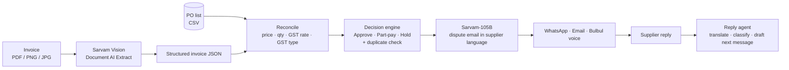

# 🚛 Freight-Invoice Reconciliation Agent

An AI agent that reads a freight invoice, checks it against the purchase order (PO), decides what to pay and what to hold, and disputes the supplier **in their own language**, ready to send on WhatsApp or email.

Built on the **Sarvam AI** stack (Vision, Sarvam-105B, Bulbul) with a **Streamlit** UI.

> **Status:** hackathon prototype. It works end to end, but it is not production software. See [Limitations](#limitations).

---

## Table of contents

- [🚛 Freight-Invoice Reconciliation Agent](#-freight-invoice-reconciliation-agent)
  - [Table of contents](#table-of-contents)
  - [The problem](#the-problem)
  - [What it does](#what-it-does)
  - [How it works](#how-it-works)
  - [Quick start](#quick-start)
  - [Configuration](#configuration)
  - [Using the app](#using-the-app)
    - [🔍 Single invoice](#-single-invoice)
    - [📊 Batch dashboard](#-batch-dashboard)
    - [💬 Supplier reply agent](#-supplier-reply-agent)
  - [PO list format (CSV)](#po-list-format-csv)
  - [Reconciliation and decision rules](#reconciliation-and-decision-rules)
    - [What gets flagged](#what-gets-flagged)
    - [Money at risk](#money-at-risk)
    - [Verdict](#verdict)
    - [Supplier trust score](#supplier-trust-score)
  - [Sarvam APIs used](#sarvam-apis-used)
  - [Sample data and demo script](#sample-data-and-demo-script)
  - [Project structure](#project-structure)
  - [Deployment](#deployment)
    - [Streamlit Community Cloud (free)](#streamlit-community-cloud-free)
  - [Troubleshooting](#troubleshooting)
  - [Limitations](#limitations)
  - [Roadmap](#roadmap)
  - [Tech stack](#tech-stack)

---

## The problem

Accounts-payable teams receive freight invoices in many formats and languages. Checking each one against a PO by hand is slow, so overbilling, wrong GST and duplicate invoices slip through. Disputing a supplier is slower still, because the dispute has to be written in a language the supplier actually reads.

## What it does

| # | Step | What happens | Powered by |
|---|------|--------------|-----------|
| 1 | **Read** | Extracts invoice number, PO number, line items, GST rate, IGST / CGST / SGST amounts and total from an uploaded invoice | Sarvam Vision (Document AI *Extract*) |
| 2 | **Reconcile** | Fuzzy-matches lines to the PO and flags price, quantity, GST rate, GST type and items not on the PO | Python |
| 3 | **Decide** | Gives a verdict (**Approve / Part-pay / Hold**) with the exact ₹ to release and ₹ to hold. Catches duplicate invoices | Python |
| 4 | **Dispute** | Drafts the email in the supplier's language with a tone selector (Polite / Firm / Final notice), plus an English back-translation for your review | Sarvam-105B |
| 5 | **Send** | Opens WhatsApp or your mail client prefilled, and can read the message aloud in the supplier's language | Sarvam Bulbul v3 |
| 6 | **Negotiate** | You paste the supplier's reply. The agent translates it, classifies it (accepted / rejected / counter-offer), recommends an action and drafts your next reply | Sarvam-105B |

Also included:

- **Batch dashboard:** process several invoices at once, ranked by money at risk, with release-now and hold totals.
- **Supplier trust score:** per-supplier history of flagged invoices and lifetime overbilling.
- **Reconciliation report:** downloadable CSV audit trail per invoice.
- **PO list upload:** bring your own POs as a CSV.
- **Safe fallbacks:** if extraction fails, the app falls back to sample data and says so. Demo mode needs no API key.

## How it works



Everything lives in a single file, `app.py`, in three layers:

1. **Logic:** extraction, reconciliation, decision engine, history, report builder.
2. **Sarvam clients:** Document AI extract job, chat completions, text-to-speech.
3. **UI:** Streamlit, with three tabs (Single invoice, Batch dashboard, Supplier reply agent).

## Quick start

**Requirements:** Python 3.9 or newer and a Sarvam API key from <https://dashboard.sarvam.ai>.

```bash
git clone https://github.com/deepu1965/Freight-invoice.git
cd Freight-invoice
pip install -r requirements.txt
streamlit run app.py
```

The app opens at <http://localhost:8501>.

With no key, it starts in **Demo mode** using built-in sample data, so you can explore everything except the live Sarvam calls.

## Configuration

The app looks for your Sarvam key in this order:

| Method | How | Best for |
|--------|-----|----------|
| Streamlit secrets | `SARVAM_API_KEY = "..."` in `.streamlit/secrets.toml` or the Cloud *Secrets* box | Deployment |
| Environment variable | `export SARVAM_API_KEY="..."` (PowerShell: `$env:SARVAM_API_KEY="..."`) | Local development |
| Sidebar field | Paste into **Sarvam API key** (kept in memory only) | Quick testing |

Sidebar settings:

- **Demo mode:** skip Sarvam extraction and use sample data.
- **Auto-hold threshold:** if overbilling is at least this percentage of the invoice, the verdict becomes Hold instead of Part-pay (default 50%).
- **PO list upload:** replace the built-in POs with your own CSV.
- **Reset supplier history:** clears the saved ledger and duplicate memory.

> Never commit your API key. `.gitignore` already excludes `.streamlit/secrets.toml`, `.env` and the local history file.

## Using the app

### 🔍 Single invoice

1. Upload an invoice (PNG, JPG or PDF up to 10 pages) or click **▶ Run with sample invoice**.
2. Review the **verdict banner** (Approve / Part-pay / Hold) with **Pay now** and **Hold** amounts.
3. Check the **supplier trust score** and the **mismatch table** (type, item, detail, ₹ impact).
4. Choose a tone and click **Draft in \<language\>**. The language comes from the PO record.
5. Send it: **Send on WhatsApp**, **Open in email**, or **Hear it** for audio.
6. Download the **reconciliation report (CSV)** for your records.

### 📊 Batch dashboard

Upload several invoices (or load the samples) to get one table sorted by money at risk, a bar chart per supplier, and totals for **Release now** and **Hold / recover**.

### 💬 Supplier reply agent

After analysing an invoice, paste the supplier's reply in their language. The agent returns:

- an English translation,
- a stance: `ACCEPTED`, `REJECTED`, `COUNTER_OFFER` or `UNCLEAR`,
- a one-line summary and a recommended action,
- your next message, written in the supplier's language.

## PO list format (CSV)

One row per PO line. A template is available in the sidebar and in `sample_pos.csv`.

```csv
po_number,supplier,language,gst_rate,item,qty,price,email,gst_type
PO-1001,Sri Lakshmi Transport,Tamil,5,Chennai-Hyderabad FTL,2,42000,accounts@example.com,IGST
PO-1001,Sri Lakshmi Transport,Tamil,5,Loading charges,2,1500,accounts@example.com,IGST
```

| Column | Required | Notes |
|--------|----------|-------|
| `po_number` | yes | Must match the PO number on the invoice (spaces and case are ignored) |
| `supplier` | yes | Supplier name |
| `language` | yes | Tamil, Hindi, Telugu, Marathi, Kannada, Malayalam, Bengali, Gujarati, Punjabi or English |
| `gst_rate` | yes | Agreed GST percentage, for example `5` or `18` |
| `item` | yes | Line description. Matched to invoice lines by similarity |
| `qty` | yes | Ordered quantity |
| `price` | yes | Agreed unit price in ₹ |
| `email` | no | Used to prefill the email button |
| `gst_type` | no | `IGST` (inter-state, default) or `CGST+SGST` (intra-state) |

## Reconciliation and decision rules

### What gets flagged

| Flag | Meaning | Severity |
|------|---------|----------|
| **Price** | Invoice rate is higher than the PO rate | 🔴 |
| **Quantity** | Invoice quantity differs from the PO quantity | 🟡 |
| **Not on PO** | A billed line has no close match on the PO | 🔴 |
| **GST rate** | Charged rate differs from the agreed rate | 🔴 |
| **GST type** | Wrong tax structure (CGST+SGST charged where IGST applies, or the reverse). The buyer cannot claim input tax credit | 🔴 |
| **Duplicate** | Same supplier and invoice number submitted before | 🛑 |

### Money at risk

```
money at risk = invoice total − (PO qty × PO price) × (1 + agreed GST %)
```

Tax on the overcharge is included. Differences of ₹1 or less are ignored. If the invoice total is missing, the per-issue impacts are summed instead.

### Verdict

Checked in this order:

1. **Duplicate invoice** → 🛑 **Hold** the full amount.
2. **Wrong GST type** → 🛑 **Hold** the full amount and request a corrected invoice.
3. **No overbilling** → ✅ **Approve** and pay in full.
4. **Overbilling ≥ threshold % of the invoice** → 🛑 **Hold** and request a corrected invoice.
5. Otherwise → ⚠️ **Part-pay**: release the undisputed amount, hold the disputed balance.

### Supplier trust score

```
score = 100 × (1 − flagged invoices ÷ total invoices)
```

🟢 Reliable at 80 or above · 🟡 Watch closely at 50 to 79 · 🔴 High risk below 50.

> The three sample suppliers ship with **seeded demo history** so the scorecard has context. Real runs add to it. Use **Reset supplier history** to clear it.

## Sarvam APIs used

| Purpose | API | Model |
|---------|-----|-------|
| Invoice field extraction | Document AI `extract` job over REST (create, poll status, get results) with an inline JSON schema | Sarvam Vision 1.5 |
| Dispute emails, WhatsApp text, translation, reply analysis | `POST /v1/chat/completions` | `sarvam-105b` |
| Voice playback | `POST /text-to-speech` | `bulbul:v3` |

Supported supplier languages are listed in the [PO format](#po-list-format-csv). The API docs are at <https://docs.sarvam.ai>.

## Sample data and demo script

| File | What it demonstrates |
|------|----------------------|
| `sample_invoice_1.png` | Price + quantity + GST rate errors (Tamil supplier) |
| `sample_invoice_gsttype.png` | Correct amounts but wrong GST type (Marathi supplier) |
| `sample_invoice_telugu.png` | Price error (Telugu supplier) |
| `sample_invoice_clean.png` | No errors (Hindi supplier) |
| `sample_pos.csv` | PO list template |

Regenerate the images with `python make_samples.py` (needs Pillow).

**3-minute demo**

1. Sidebar → **Reset supplier history**.
2. **Batch dashboard** → *Load sample invoices* and show release-now vs hold.
3. **Single invoice** → *Run with sample invoice* and show the part-pay verdict, trust score and mismatches.
4. *Draft in Tamil* → *Hear it* → *Send on WhatsApp*.
5. Click *Run with sample invoice* again → duplicate hold.
6. **Supplier reply agent** → *Paste a sample supplier reply* → *Analyse reply*.

## Project structure

```
Freight-invoice/
├── app.py                    # the whole app: logic, Sarvam clients, UI
├── requirements.txt          # streamlit, pandas, requests, pillow
├── sample_pos.csv            # PO list template
├── make_samples.py           # regenerates the sample invoice images
├── sample_invoice_*.png      # demo invoices with planted errors
├── .gitignore
└── README.md
```

Created at runtime and ignored by git: `supplier_history.json`.

## Deployment

### Streamlit Community Cloud (free)

1. Push this repo to GitHub.
2. Open <https://share.streamlit.io> and sign in with GitHub.
3. Click **New app**, choose the repo, branch `main`, main file `app.py`.
4. Under **Advanced settings → Secrets**, add:
   ```toml
   SARVAM_API_KEY = "your_key_here"
   ```
5. Click **Deploy**.

Notes:

- Supplier history is stored in a local file, so it **resets when the app restarts** on Cloud.
- A public link spends your Sarvam credits. Don't share it widely.

## Troubleshooting

| Symptom | Likely cause and fix |
|---------|----------------------|
| First sample run shows a **duplicate** hold | History from earlier testing is saved. Click **Reset supplier history** |
| "Extraction failed… falling back to sample data" | Check the key, file type and the 10-page limit. Open the *Raw JSON* expander to inspect what came back |
| "PO … is not in the PO list" | The PO number on the invoice is missing from the built-in list or your CSV. The message also lists any fields extraction missed |
| Email not in the supplier's script | Click **Draft** again, or set the tone to Firm. The language comes from the PO record's `language` column |
| Voice fails | Check the key and the 1,500-character limit. The rest of the app keeps working |
| Reply agent error | The model must return JSON. Retry with a shorter reply |
| Chat `400` error | The model name may have changed. The app tries `sarvam-105b` first, then `sarvam-30b`, and shows Sarvam's error text. Check <https://docs.sarvam.ai> for current model IDs |
| `use_container_width` deprecation warnings | Harmless. They come from newer Streamlit versions |

## Limitations

- Supplier history lives in a local JSON file, not a database.
- POs come from a CSV or the built-in samples, not an ERP.
- Email and WhatsApp open prefilled. Nothing is sent automatically.
- Matching is rule-based with fuzzy line-item matching. Freight surcharges (fuel, detention) and invoices covering multiple POs are not handled.
- Extraction accepts PDF, PNG and JPG only, up to 10 pages per file.
- No authentication or role-based approval workflow.
- LLM-written emails and reply analysis should be reviewed by a person before sending or acting on them. That is why the English back-translation is shown.
- Extraction field names were checked against the sample invoices. Verify them against your own invoice formats.

## Roadmap

- Persistent database for suppliers, invoices and dispute history
- ERP integration (Tally, SAP, Zoho)
- Automatic sending via SMTP and the WhatsApp Business API, with an approval step
- Multi-PO invoices and freight surcharge rules
- Approval workflows and audit log
- Confidence scores on extracted fields, with human review of low-confidence ones

## Tech stack

Streamlit · Sarvam Document AI (Vision 1.5) · Sarvam-105B · Sarvam Bulbul v3 · pandas · Python